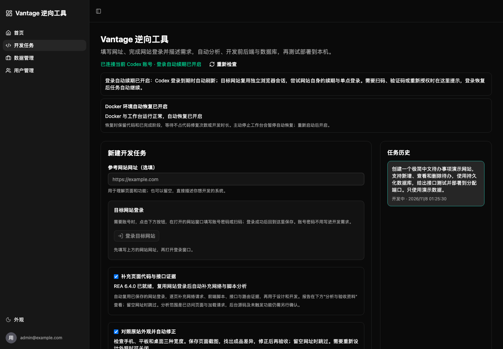

# Vantage 逆向工具

给 Vantage 一个网站地址和需求，它会分析网站页面、交互和前端资源，生成可以继续开发的网站项目，并对照参考页面检查效果。

适合网站分析、界面复刻、原型开发和 AI 辅助开发。支持登录后分析、视觉对照、项目源码下载和 MCP 调用。



## 安装与使用

当前支持 macOS。请先安装 Python 3.12、Node.js 24、npm、uv 和 Docker Compose，启动 Docker，并登录 Codex 账号。

```bash
git clone https://github.com/Aiysae/vantage-reverse.git
cd vantage-reverse
./setup.sh
./workbench.sh agent-check
./workbench.sh up
```

打开 [http://127.0.0.1:18780/develop](http://127.0.0.1:18780/develop)，输入网站地址和开发需求，开始任务。需要登录的参考网站，可在工作台打开登录窗口并保存登录状态。

停止工作台：

```bash
./workbench.sh stop
```

## MCP 接入

在支持 MCP 的客户端中，将项目目录下的 `tools/.venv/bin/python` 设为命令，`scripts/vantage_mcp.py` 设为参数。启动工作台后，即可通过 Agent 创建任务、查看进度和读取报告。

## 许可证

[MIT](LICENSE) · 基于 [Full Stack FastAPI Template](https://github.com/fastapi/full-stack-fastapi-template)，原项目许可证见 [app/LICENSE](app/LICENSE)。
